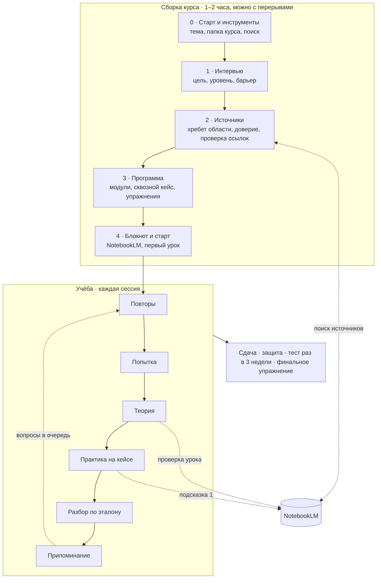

# course-builder

**Скилл для Claude Code, который собирает курс под тебя и ведёт по нему.**

Говоришь «собери мне курс по UX-исследованиям». Claude выясняет, что ты уже умеешь и где застреваешь, находит и проверяет источники, строит программу на сквозном кейсе с героями, у которых есть скрытые цели, подключает блокнот NotebookLM. Дальше ведёт уроки, проверяет работы, устраивает защиты, возвращает вопросы на повтор и через недели проверяет, что осталось в голове.

Это не генератор глав. Главы AI пишет почти бесплатно, и в этом ловушка: перечитывание даёт ощущение понимания, которое не равно умению. Поэтому курс здесь — это задачи, попытки до теории, подсказки вместо готовых ответов и проверки без AI.

---

## Быстрый старт

### 1. Установи скилл

Один из трёх способов:

```bash
# через skills CLI
npx skills add kaspruknikita-tech/course-builder -g -a claude-code

# или через git
git clone https://github.com/kaspruknikita-tech/course-builder.git ~/.claude/skills/course-builder
```

Или скачай ZIP (зелёная кнопка **Code → Download ZIP**) и распакуй в `~/.claude/skills/course-builder/`. На Windows это `%USERPROFILE%\.claude\skills\course-builder\`. Внутри должен лежать `SKILL.md`.

### 2. Поставь поиск источников (рекомендуется)

Без этого курс тоже соберётся, но искать источники будет только встроенный поиск, и охват будет уже. Две команды, ключи не нужны:

```bash
claude mcp add --scope user --transport http exa https://mcp.exa.ai/mcp
claude mcp add --scope user --transport http firecrawl https://mcp.firecrawl.dev/v2/mcp
```

После установки **перезапусти Claude Code**: серверы подключаются при запуске. Подробности, ключи API и тематические серверы — [ниже](#инструменты).

### 3. Попроси курс

```bash
claude
```

```
> собери мне курс по UX-исследованиям
```

Скилл сработает сам. Можно и явно: `/course-builder`.

Python 3 нужен для двух вспомогательных скриптов: создание папки курса и проверка ссылок. Без него Claude сделает то же вручную, просто медленнее.

---

## Как это выглядит

Каждый шаг заканчивается блоком, где сказано, что сделать тебе — одно действие, время и фраза, которой продолжить:

```
━━ Этап 2 из 4 · Источники ━━
Готово: 26 источников, у каждой из 7 тем есть главный → _course/sources.md
Твой ход: пролистай 6 главных источников из таблицы выше (≈20 мин), скажи, что не подходит
Потом напиши: «ок» или что убрать
```

Ушёл на неделю и забыл, где остановился, — напиши «где я». Claude прочитает состояние курса и даст следующее действие.

Пример урока из курса по UX:

> **Попытка.** Два вопроса до теории: «Чем юзабилити-тест отличается от интервью?» и «Сервис доставки жалуется на брошенные корзины — с чего начнёшь?». Правильность не оценивается, теория ляжет на твои ответы.
>
> **Теория.** Урок с метками источников `[ISO9241-210]`, `[NNg-usability-testing]`, — чтобы проверить его в NotebookLM.
>
> **Практика.** Сценарий теста для сквозного кейса. Продакт-менеджер кейса хочет «просто проверить, нравится ли дизайн». Если спросишь правильно — выяснишь, что на самом деле от теста ждёт директор.
>
> **Разбор** по эталону, написанному до твоего ответа, и **три вопроса на припоминание**, которые вернутся через 2, 5 и 10 сессий.

---

## Пайплайн



| Этап | Что делает Claude | Что делаешь ты | Время |
|---|---|---|---|
| **0. Старт и инструменты** | создаёт папку курса, проверяет поиск, предлагает поставить недостающее | выбираешь папку, ставишь 1–2 сервера, перезапускаешь | 5–10 мин |
| **1. Интервью** | спрашивает по 2–3 вопроса, проводит мини-диагностику из 6 вопросов | отвечаешь: цели, опыт, где застреваешь | 20–30 мин |
| **2. Источники** | ищет хребет области, ставит каждому источнику уровень доверия, проверяет ссылки | запускаешь поиск в NotebookLM по готовому запросу, приносишь свои материалы, пролистываешь главные источники | 30 мин |
| **3. Программа** | модули, сквозной кейс со скрытыми фактами, упражнения, проверки, срок | утверждаешь или правишь | 10–15 мин |
| **4. Блокнот и старт** | план блокнота, запросы, первый урок | создаёшь блокнот, загружаешь источники модуля 1 | 10 мин |

Бриф и программу утверждаешь ты: без твоего «да» следующий этап не начинается.

### Как скилл узнаёт, что тебе нужно

Интервью задаёт три вопроса, которые меняют саму структуру курса, а не отдельные уроки:

- **Тип цели** — понять область глубоко, навык для работы, смена профессии или экзамен. От него зависит порядок модулей: по сложности задач или по истории школ.
- **Уровень по диагностике**, а не по самооценке: шесть вопросов от базовых до продвинутых. Люди систематически переоценивают своё понимание, особенно после чтения и разговоров с AI. Знакомое сворачивается, курс начинается с твоего уровня.
- **Барьер** — где ты застреваешь или действуешь наугад, на примере последнего случая. Барьер задаёт масштаб сквозного кейса, ранний глубокий модуль и серию упражнений.

Остальное — время, язык, свои материалы, бюджет, где практиковаться.

---

## Учёба

Открой Claude Code в папке курса (`cd ~/courses/ux-research && claude`) и пиши:

| Напиши | Что будет |
|---|---|
| **урок** | повторы → попытка → теория → практика → разбор → припоминание |
| **упражнение** | процедура на новом кейсе; шпаргалка и подсказки с каждым разом убывают |
| **застрял** | подсказка по одной ступени: вопрос к блокноту → какое правило применить → пример на другом кейсе → эталон только после сдачи |
| **сдаю** | проверка работы модуля по чек-листу: принят, доработка или не принят |
| **защита** | 5 вопросов от комиссии из героев кейса, в самое слабое место |
| **повтор** | только вопросы, которым пришло время |
| **тест** | 9 вопросов без конспектов и AI, раз в 3 недели |
| **прогресс** | модули, доля верных ответов, тренд подсказок, тесты |
| **поменять программу** | правка программы; новое — только вместо старого |
| **где я** | одно следующее действие |

### Сквозной кейс и скрытые факты

Вся практика идёт на одном вымышленном проекте. У героев есть публичная позиция и скрытая цель, у проекта — факты, которые всплывают, только если задать правильный вопрос. Умение спросить — часть навыка почти любой профессии, и кейс тренирует именно его. Если в профессии несколько типов работы — у UX, например, исследование, проектирование и дизайн-система, — в кейсе есть поток на каждый тип, а конфликты между потоками становятся учебным материалом.

В конце модулей кейс ломается: приходит событие «план сломался», и у тебя 5 минут на ответ.

### Главная метрика

Первое упражнение (D1) в конце курса повторяется в параллельной форме (D1′): новый кейс того же типа, без шпаргалки и подсказок. Разница в баллах, вскрытых фактах и времени — честный ответ на вопрос, научился ли ты.

---

## NotebookLM

Каждый курс работает в паре с блокнотом [NotebookLM](https://notebook.google.com) (в 2026 году Google переименовал его в Gemini Notebook). Блокнот отвечает только по загруженным источникам и показывает цитаты. В курсе у него три работы:

1. **Проверяет уроки.** Урок пишет модель, а модель иногда уверенно ошибается. Блокнот находит утверждения урока, которых нет в источниках, и урок исправляется.
2. **Даёт первую подсказку.** Не понял понятие — вопрос к блокноту, ответ с цитатой из первоисточника.
3. **Ищет источники** своим Deep Research — второй канал поиска к поиску Claude.

Режим ручной: Claude готовит файл и точный текст запроса, ты вставляешь его в блокнот и приносишь ответ. Автоматизации нет намеренно. У обычных аккаунтов нет официального API, сторонние инструменты работают через куки браузера и могут привести к ограничениям аккаунта. Без NotebookLM курс тоже работает: проверка уроков идёт по локальным файлам источников, но она слабее.

---

## Инструменты

Скилл проверяет, что у тебя есть, на этапе 0 и предлагает поставить недостающее. Всё ниже бесплатно.

### Поиск источников

| Сервер | Что даёт | Установка без ключа |
|---|---|---|
| встроенный WebSearch / WebFetch | базовый поиск, есть в Claude Code из коробки | — |
| [Exa](https://exa.ai/mcp) | поиск по смыслу: первоисточники, исследования, документация | `claude mcp add --scope user --transport http exa https://mcp.exa.ai/mcp` |
| [Firecrawl](https://docs.firecrawl.dev/mcp-server) | поиск и чтение длинных страниц и PDF | `claude mcp add --scope user --transport http firecrawl https://mcp.firecrawl.dev/v2/mcp` |

### Ключи API: когда бесплатного лимита мало

Без ключа лимит небольшой, а исследование для курса — это 30–40 запросов. Кончится лимит — инструмент вернёт ошибку. Бесплатный ключ поднимает лимит:

1. **Exa:** зарегистрируйся на [exa.ai](https://exa.ai), создай ключ на странице [dashboard.exa.ai/api-keys](https://dashboard.exa.ai/api-keys).
2. **Firecrawl:** зарегистрируйся на [firecrawl.dev](https://www.firecrawl.dev), ключ — в личном кабинете, раздел API Keys.
3. Переподключи серверы с ключом. Команды выполняй **сам в терминале**, ключ в чат не вставляй:

   ```bash
   claude mcp remove exa -s user
   claude mcp add --scope user --transport http exa https://mcp.exa.ai/mcp --header "x-api-key: ТВОЙ_КЛЮЧ"

   claude mcp remove firecrawl -s user
   claude mcp add --scope user --transport http firecrawl https://mcp.firecrawl.dev/v2/mcp --header "Authorization: Bearer ТВОЙ_КЛЮЧ"
   ```

4. Перезапусти Claude Code и попроси что-нибудь найти: так проверяется сам ключ. Отметка «✓ Connected» в `claude mcp list` появляется и с неверным ключом.

> **Ключ — как пароль.** Claude Code хранит его открытым текстом в `~/.claude.json`: этот файл не публикуй и не коммить. Ключ утёк — отзови его в кабинете сервиса и создай новый.

### По теме курса

Скилл предложит их сам, если тема подходит:

| Тема | Сервер | Установка | Зачем |
|---|---|---|---|
| программирование | Context7 | `claude mcp add --scope user --transport http context7 https://mcp.context7.com/mcp` | уроки по актуальной документации библиотек |
| UX, веб, доступность | Playwright | `claude mcp add --scope user playwright -- npx @playwright/mcp@latest` | разбирать живые сайты: скриншоты, сценарии; нужен Node.js |
| дизайн интерфейсов | Figma | `claude plugin install figma@claude-plugins-official` | практика на своих макетах; на бесплатном тарифе Figma лимит низкий |

---

## Папка курса

```
~/courses/ux-research/
├── CLAUDE.md          напоминает Claude, что это курс
├── README.md          как учиться в этом курсе
├── lessons/           уроки по модулям
├── work/              твои работы и учебные данные
├── materials/         PDF и файлы источников
└── _course/           служебное
    ├── build.md       ход сборки
    ├── brief.md       твой бриф из интервью
    ├── sources.md     источники с уровнем доверия
    ├── research.md    почему выбраны эти источники
    ├── program.md     модули, уроки, практика, чек-листы
    ├── case.md        сквозной кейс — открытая часть
    ├── case-hidden.md скрытые цели и факты — не открывать
    ├── drills.md      упражнения со скрытыми фактами — не открывать
    ├── keys/          эталоны — не открывать до разбора
    ├── notebook.md    что загружено в NotebookLM
    ├── state.md       где ты сейчас
    ├── log.md         журнал сессий
    └── queue.md       очередь повторов
```

Курсов может быть несколько: реестр лежит в `~/.course-builder/courses.md`. Курс живёт в файлах, поэтому его можно перенести, положить в git или продолжить на другом компьютере.

---

## Почему так устроено

| Правило курса | На чём стоит |
|---|---|
| попытка до теории, проверка вместо перечитывания | из десяти учебных техник высокую пользу показали только самопроверка и распределённая практика ([Dunlosky et al., 2013](https://www.psychologicalscience.org/news/releases/which-study-strategies-make-the-grade.html)); перечитывание даёт иллюзию знакомости ([Bjork & Bjork, 2011](https://bjorklab.psych.ucla.edu/wp-content/uploads/sites/13/2016/04/EBjork_RBjork_2011.pdf)) |
| подсказки вместо ответов, эталон готов заранее | обычный GPT-4 поднял результат школьников на практике, но на экзамене без AI они написали на 17% хуже контрольной группы; тьютор с подсказками и заложенными решениями этот вред снял ([Bastani et al., PNAS, 2025](https://www.pnas.org/doi/10.1073/pnas.2422633122)) |
| отложенный тест без AI как главная метрика | ChatGPT как опора при учёбе снизил результат теста через 45 дней с 68,5% до 57,5% ([Barcaui, 2025](https://doi.org/10.1016/j.ssaho.2025.102287)) |
| курс из задач на кейсе, поддержка убывает | модель 4C/ID ван Мерриенбура для сложных профессиональных навыков ([4cid.org](https://www.4cid.org/about/)) |
| хорошо устроенный AI-тьютор работает | в Гарварде AI-тьютор с пошаговыми подсказками удвоил прирост знаний по сравнению с активным занятием в аудитории ([Kestin et al., 2025](https://pmc.ncbi.nlm.nih.gov/articles/PMC12179260/)) |

---

## Частые вопросы

**Сколько это стоит?** Скилл бесплатный. Нужна подписка Claude с доступом к Claude Code. Сборка курса, особенно поиск источников, расходует заметную часть лимита, поэтому её удобно растянуть на 2–3 сессии. Exa, Firecrawl и NotebookLM — бесплатные.

**Работает в claude.ai в браузере?** Курс живёт в файлах, поэтому нужен Claude Code: терминал, десктоп или расширение для IDE.

**Можно курс на английском?** Да, язык уроков выбирается в интервью.

**Курс получился слишком длинным.** На этапе 3 скилл сверяет срок с твоим временем. Если не влезает, режет вместе с тобой: сначала уходит то, что не служит ни целям, ни барьеру. Потом — «поменять программу».

**Серверы не появились после установки.** Перезапусти Claude Code и проверь `claude mcp list`.

**Можно ли учить свой реальный проект?** Да, вторым потоком практики, но без конфиденциальных данных работодателя и клиентов.

---

## Обратная связь

Нашёл ошибку, курс собрался странно, есть идея — открой [issue](https://github.com/kaspruknikita-tech/course-builder/issues). Самое полезное: тема курса, что ожидал, что получилось, на каком этапе.

## Автор и лицензия

Автор — **Nikita Kaspruk** ([github.com/kaspruknikita-tech](https://github.com/kaspruknikita-tech)). Скилл собран из двух исследований о самостоятельном обучении с AI и опыта трёх курсов, построенных по этому пайплайну.

Лицензия [CC BY 4.0](LICENSE): можно делиться и переделывать для любых целей с указанием автора.
