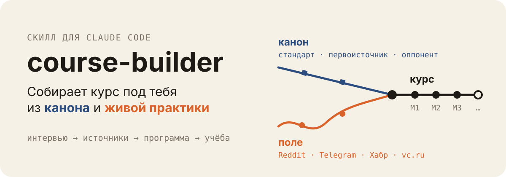
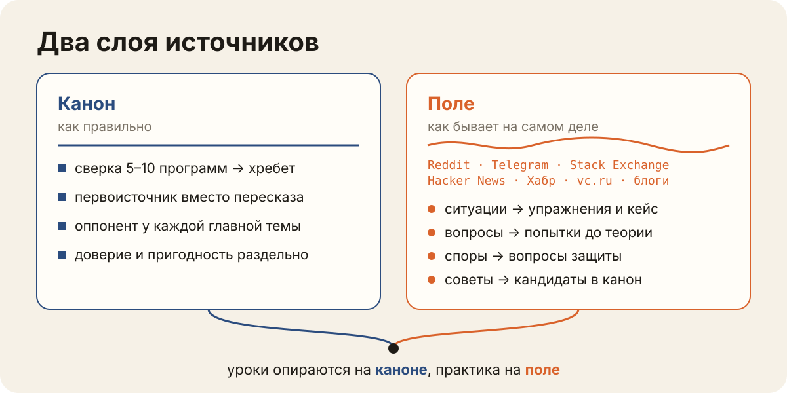
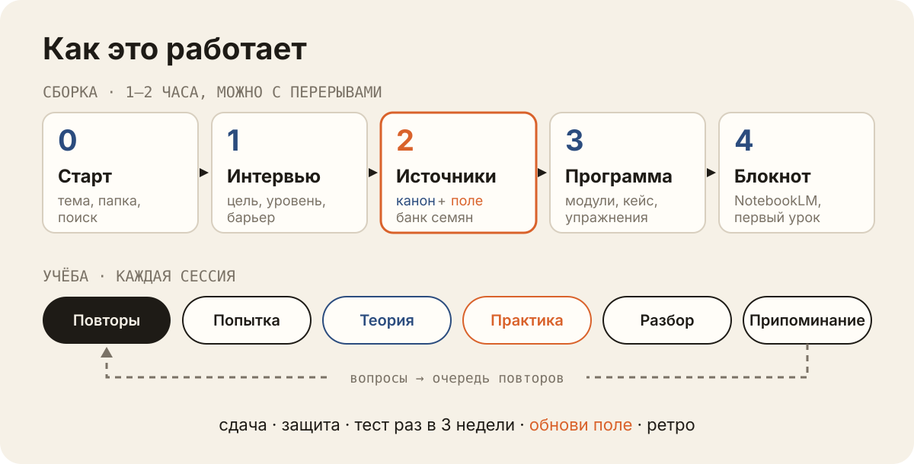

<a id="top"></a>

<p align="center">
  
</p>

<p align="center">
  <a href="#быстрый-старт"></a>
  <a href="https://github.com/kaspruknikita-tech/course-builder/releases"></a>
  <a href="LICENSE"></a>
  
  
  <a href="https://github.com/kaspruknikita-tech/course-builder/actions/workflows/checks.yml"></a>
</p>

<p align="center">
  <a href="#быстрый-старт">Быстрый старт</a> ·
  <a href="#как-это-выглядит">Как это выглядит</a> ·
  <a href="#откуда-берутся-источники">Источники</a> ·
  <a href="#как-это-работает">Как работает</a> ·
  <a href="#учёба">Учёба</a> ·
  <a href="#инструменты">Инструменты</a> ·
  <a href="#частые-вопросы">FAQ</a>
</p>

Ты пишешь Claude что-нибудь вроде «собери мне курс по UX-исследованиям», и дальше он делает то, что обычно делает хороший преподаватель перед началом занятий: расспрашивает, что ты уже умеешь и на чём спотыкаешься в работе, ищет и проверяет источники, собирает программу под твой уровень и время и подключает блокнот NotebookLM, чтобы было где перепроверять факты. После этого он ведёт тебя по курсу: проводит уроки, смотрит твои работы, возвращает вопросы, которые ты начал забывать, и через пару недель проверяет, что осталось в голове, когда рядом нет ни конспекта, ни AI.

Читать здесь придётся меньше, чем в обычном онлайн-курсе, потому что большая часть времени уходит на задачи. Сначала ты пробуешь ответить сам, даже если ничего не знаешь, потом читаешь теорию, которая ложится уже на твой вопрос, а потом делаешь практику на учебном проекте. Когда застреваешь, Claude подсказывает по одному шагу, а свой эталонный ответ показывает только после того, как ты сдал собственный, иначе было бы слишком легко просто переписать готовое.

## Как это выглядит

После каждого шага Claude коротко пишет, что уже сделано, что теперь нужно от тебя, сколько это займёт и какой фразой продолжить, так что вопрос «а что дальше?» не возникает даже после недельного перерыва:

```
━━ Этап 2 из 4 · Источники ━━
Готово: 26 источников, у каждой из 7 тем есть главный и оппонент; 14 семян из 9 живых сообществ
Твой ход: пролистай 6 главных источников из таблицы выше (≈20 мин), скажи, что не подходит
Потом напиши: «ок» или что убрать
```

> [!TIP]
> Если ты забыл, где остановился, просто напиши «где я». Claude прочитает файлы курса, поймёт, на каком ты этапе, и скажет, что делать дальше, даже если это новая сессия и старой переписки у него нет.

Так выглядит урок в курсе по UX:

| Шаг | Что происходит |
|---|---|
| Попытка | Два вопроса до теории, например «Чем юзабилити-тест отличается от интервью?». Оценки нет, это разминка |
| Теория | Урок со ссылками на источники вроде `[ISO9241-210]`. По ним урок потом проверяется в NotebookLM |
| Практика | Сценарий теста для учебного проекта. Продакт хочет «просто проверить, нравится ли дизайн», а что нужно директору, ты узнаешь, только если спросишь |
| Разбор | Claude сравнивает твою работу с эталоном, который написал до твоего ответа, и называет одну главную правку |
| Припоминание | Три вопроса, которые вернутся через 2, 5 и 10 сессий |

## Откуда берутся источники

Если попросить AI посоветовать литературу, он обычно перечисляет «лучшие книги по теме» по памяти, и половина списка оказывается пересказами пересказов. Этот скилл ищет источники в два захода, и у каждого своя задача.

<p align="center">
  
</p>

Первый заход, канон, отвечает на вопрос, как правильно. Claude находит 5–10 программ по твоей теме, от университетских курсов до программ профессиональных сообществ, роадмапов и вакансий, и смотрит, какие книги и стандарты повторяются в нескольких из них, потому что такому совпадению можно доверять больше, чем мнению одной модели. Пересказы он по возможности заменяет оригиналами, к каждой большой теме ищет хотя бы одного критика, чтобы курс не учил одну школу как единственную правду, а у каждого источника отмечает, какие главы стоит читать и подходят ли они тебе по уровню.

Второй заход, поле, показывает, как всё бывает в жизни. Claude находит сообщества, где люди этой профессии обсуждают свою работу, собирает оттуда посты за последний год и отбирает реальные ситуации, вопросы, которые люди задают друг другу, и споры, в которых профессия сама с собой не согласна. Из ситуаций потом получаются задачи для упражнений и неожиданные повороты в учебном проекте, из вопросов разминки перед теорией, а из споров неудобные вопросы на защите. Отрасль, имена и цифры в задаче меняются, чтобы ты решал, а не вспоминал знакомую историю, а раз в месяц можно попросить «обнови поле» и получить свежие ситуации.

<p>
  
  
  
  
  
  
  
</p>

Готового списка каналов в скилле нет, поэтому одинаково хорошо получается и курс по DevOps, и курс по поддержке клиентов: для каждой темы Claude ищет сообщества заново и проверяет, что они живые и в них пишут текстом, а не только выкладывают картинки и вакансии. Посты практиков при этом идут только в задачи, потому что пост одного человека ещё не доказательство, а факты, на которых стоят уроки, берутся из канона.

## Как это работает

<p align="center">
  
</p>

| Этап | Что делает Claude | Что делаешь ты | Время |
|---|---|---|---|
| 0. Старт | создаёт папку курса, проверяет поиск, предлагает поставить то, чего не хватает | выбираешь папку, ставишь 1–2 сервера, перезапускаешь Claude Code | 5–10 мин |
| 1. Интервью | задаёт вопросы по 2–3 за раз и шесть вопросов на проверку уровня | отвечаешь | 20–30 мин |
| 2. Источники | собирает канон и поле | запускаешь поиск в NotebookLM, называешь свои книги и каналы, пролистываешь главные источники | 30–40 мин |
| 3. Программа | модули, учебный проект, упражнения, проверки, срок | соглашаешься или правишь | 10–15 мин |
| 4. Блокнот | готовит список для NotebookLM и первый урок | создаёшь блокнот, загружаешь источники первого модуля | 10 мин |

Ключевые решения остаются за тобой: пока ты не согласился с тем, как Claude понял твои цели, и с самой программой, следующий этап не начнётся.

Из всего интервью сильнее всего на курс влияют три ответа. Первый касается того, зачем тебе вообще эта тема: если хочется по-настоящему разобраться в школах и подходах, модули выстраиваются по их истории, а если нужна работа, то по сложности задач, которые придётся решать. Второй ответ про твой уровень, и здесь Claude не верит на слово, а задаёт шесть коротких вопросов от простых к сложным, потому что после чтения статей и разговоров с AI почти все думают, что знают тему лучше, чем на самом деле. Третий, и, пожалуй, самый важный, про то, где ты застреваешь в реальной работе, лучше всего на примере последнего такого случая: от этого зависит, каким будет учебный проект и что именно ты будешь тренировать в упражнениях.

## Быстрый старт

Установи скилл:

```bash
npx skills add kaspruknikita-tech/course-builder -g -a claude-code
```

<details>
<summary>Другие способы: git или ZIP</summary>

<br>

```bash
git clone https://github.com/kaspruknikita-tech/course-builder.git ~/.claude/skills/course-builder
```

Можно скачать ZIP (Code → Download ZIP). В архиве лежит папка `course-builder-main`, её надо переименовать в `course-builder` и положить в `~/.claude/skills/` (на Windows в `%USERPROFILE%\.claude\skills\`). Проверь, что файл лежит по пути `~/.claude/skills/course-builder/SKILL.md`. Если там окажется лишняя вложенная папка, Claude Code скилл не найдёт.

</details>

Дальше по желанию можно подключить два поисковых сервера, Exa и Firecrawl. Без них курс тоже соберётся на встроенном поиске Claude Code; с ними у Claude появляются ещё два поисковика, а Firecrawl вдобавок умеет читать длинные страницы и PDF, которые встроенное чтение страниц обрезает. Сразу заведи на обоих сервисах бесплатные ключи: без ключа лимит очень маленький (у Exa он у нас закончился после трёх запросов), а на поиск для одного курса уходит 30–40 запросов, так что без ключей поиск сломается посреди сборки. Как получить ключи, написано в разделе [Инструменты](#инструменты); подключаются серверы так, причём команды с ключами лучше выполнять самому в терминале, а не просить об этом Claude:

```bash
claude mcp add --scope user --transport http exa https://mcp.exa.ai/mcp --header "x-api-key: ТВОЙ_КЛЮЧ"
claude mcp add --scope user --transport http firecrawl https://mcp.firecrawl.dev/v2/mcp --header "Authorization: Bearer ТВОЙ_КЛЮЧ"
```

После этого перезапусти Claude Code, потому что новые серверы подключаются только при старте.

Попроси курс:

```
> собери мне курс по UX-исследованиям
```

Скилл подхватит такую просьбу сам, но можно позвать его и явно командой `/course-builder`. Для вспомогательных скриптов, которые создают папку курса, проверяют ссылки и собирают посты, нужен Python 3; если его нет, Claude справится и без них, просто потратит больше времени.

## Учёба

Открой Claude Code в папке курса (`cd ~/courses/ux-research && claude`) и пиши:

| Что написать | Что будет |
|---|---|
| урок | следующий урок: повторы, попытка, теория, практика, разбор, припоминание |
| упражнение | задача на новом проекте, взятом из реальной ситуации; подсказок с каждым разом меньше |
| застрял | подсказка на один шаг. Сначала вопрос к блокноту, потом какое правило применить, потом пример на другой задаче. Эталон только после сдачи |
| сдаю | проверка работы по чек-листу модуля |
| защита | пять неудобных вопросов от героев учебного проекта |
| повтор | только вопросы, которым пришло время |
| тест | 9 вопросов без конспектов и AI, раз в 3 недели |
| прогресс | сколько пройдено, сколько верных ответов, сколько подсказок |
| обнови поле | свежие ситуации и вопросы из сообществ |
| ретро | раз в 8 сессий: что работает, что заменить (не больше трёх правок) |
| отзыв | черновик issue в этот репозиторий; без твоего «да» не публикуется |
| поменять программу | правка программы; что-то новое можно добавить только вместо старого |
| где я | следующий шаг |

Вся практика идёт на одном вымышленном проекте, который проходит через весь курс. У его героев есть собственные цели, о которых они предпочитают молчать, и факты, которые они расскажут только в ответ на точный вопрос, потому что умение спросить правильно нужно почти в любой профессии и само по себе не появляется. В конце модулей в проекте что-нибудь ломается, и у тебя есть пять минут, чтобы решить, что теперь делать и кому об этом сказать.

Самое первое упражнение в конце курса повторяется ещё раз, на новом проекте того же типа, но уже без шпаргалки и подсказок. Сравнив баллы и время с первым разом, ты увидишь, чему действительно научился, и это гораздо честнее, чем ощущение «вроде понял».

## NotebookLM

К каждому курсу подключается блокнот [NotebookLM](https://notebook.google.com) (в 2026 году Google переименовал его в Gemini Notebook). Его главное достоинство в том, что он отвечает только по загруженным в него источникам и всегда показывает цитату, поэтому в курсе он работает проверяющим: находит в уроках утверждения, которых нет в источниках, объясняет непонятные понятия словами первоисточника, а не памяти модели, и вдобавок сам ищет источники, которые Claude мог пропустить.

> [!NOTE]
> С блокнотом ты работаешь руками: Claude готовит точный текст запроса, ты вставляешь его в NotebookLM и приносишь ответ обратно. Автоматизировать это можно было бы только через сторонние инструменты, которые ходят в Google через куки браузера, потому что официального API у обычных аккаунтов нет, а за такое аккаунт могут и ограничить. Без NotebookLM курс тоже работает, просто уроки тогда сверяются с локальными файлами источников, и эта проверка слабее.

## Инструменты

На самом первом шаге Claude смотрит, что у тебя уже установлено, и предлагает поставить то, чего не хватает. Всё перечисленное ниже бесплатно.

<details>
<summary><b>Поиск и ключи API</b></summary>

<br>

| Сервер | Что даёт | Без ключа |
|---|---|---|
| встроенные WebSearch и WebFetch | обычный поиск и чтение страниц, уже есть в Claude Code | ключ не нужен |
| [Exa](https://exa.ai/mcp) | отдельный поисковик со своим индексом | работает, но лимит кончается за несколько запросов |
| [Firecrawl](https://docs.firecrawl.dev/mcp-server) | поиск плюс чтение длинных страниц и PDF | работает с небольшим лимитом |

Для курса нужны ключи: на поиск источников уходит 30–40 запросов, а без ключа лимита на это не хватит. Ключи бесплатные, и завести их можно за пару минут:

1. Exa: зарегистрируйся на [exa.ai](https://exa.ai) и создай ключ на [dashboard.exa.ai/api-keys](https://dashboard.exa.ai/api-keys).
2. Firecrawl: зарегистрируйся на [firecrawl.dev](https://www.firecrawl.dev), ключ лежит в личном кабинете в разделе API Keys.
3. Подключи серверы с ключом. Делай это сам в терминале и не вставляй ключ в чат. Если сервер уже был добавлен без ключа, сначала удали его первой командой из пары:

   ```bash
   claude mcp remove exa -s user
   claude mcp add --scope user --transport http exa https://mcp.exa.ai/mcp --header "x-api-key: ТВОЙ_КЛЮЧ"

   claude mcp remove firecrawl -s user
   claude mcp add --scope user --transport http firecrawl https://mcp.firecrawl.dev/v2/mcp --header "Authorization: Bearer ТВОЙ_КЛЮЧ"
   ```

4. Перезапусти Claude Code и попроси что-нибудь найти. «✓ Connected» в `claude mcp list` пишется и при неправильном ключе, так что проверить можно только поиском.

> [!WARNING]
> Ключ храни как пароль. Claude Code записывает его открытым текстом в `~/.claude.json`, этот файл никуда не выкладывай. Если ключ утёк, отзови его в кабинете сервиса и сделай новый.

</details>

<details>
<summary><b>Сбор постов из сообществ</b></summary>

<br>

Посты из сообществ собирает скрипт `scripts/field.py`, которому не нужны ни дополнительные пакеты, ни ключи, ни MCP-серверы. Он читает только то, что открыто всем: превью публичных Telegram-каналов, публичный архив Reddit, открытые API Stack Exchange и Hacker News и RSS-ленты. Сайты, у которых нет ленты по теме, вроде vc.ru, Claude просматривает обычным поиском. MCP-серверы для Telegram я сознательно не использую, потому что им нужен вход в твой аккаунт.

```bash
field.py find-reddit sre devops        # найти сабреддиты по теме
field.py find-se devops                # найти сайты Stack Exchange
field.py check   <курс>/_course/field  # проверить, что источники живые
field.py harvest <курс>/_course/field --days 365
field.py digest  <курс>/_course/field  # короткая выжимка для отбора
field.py yield   <курс>/_course/field  # какие источники что-то дали
```

</details>

<details>
<summary><b>Серверы под тему курса</b></summary>

<br>

Эти серверы Claude предложит сам, если они пригодятся именно для твоей темы:

| Тема | Сервер | Установка | Зачем |
|---|---|---|---|
| программирование | Context7 | `claude mcp add --scope user --transport http context7 https://mcp.context7.com/mcp` | свежая документация библиотек |
| UX, веб, доступность | Playwright | `claude mcp add --scope user playwright -- npx @playwright/mcp@latest` | открывать живые сайты, делать скриншоты; нужен Node.js |
| дизайн интерфейсов | Figma | `claude plugin install figma@claude-plugins-official` | работать со своими макетами; на бесплатном тарифе Figma лимит маленький |

</details>

<details>
<summary><b>Другие скиллы</b></summary>

<br>

Для самого курса они не нужны, но могут пригодиться.

| Скилл | Зачем |
|---|---|
| [task-observer](https://github.com/rebelytics/one-skill-to-rule-them-all) | если хочешь дорабатывать сам course-builder: записывает, где скилл ошибся |
| скилл для исследований, например [claude-deep-research-skill](https://github.com/199-biotechnologies/claude-deep-research-skill) | можно использовать для поиска канона, если он у тебя уже стоит; проверь, что он нормально работает на языке курса |

</details>

## Папка курса

<details>
<summary>Что где лежит</summary>

<br>

```
~/courses/ux-research/
├── CLAUDE.md          говорит Claude, что это курс
├── README.md          как учиться в этом курсе
├── lessons/           уроки
├── work/              твои работы и учебные данные
├── materials/         PDF и другие файлы источников
└── _course/           служебные файлы
    ├── build.md       как идёт сборка
    ├── brief.md       твои ответы из интервью
    ├── sources.md     канон
    ├── research.md    почему выбраны эти источники
    ├── program.md     модули, уроки, практика, чек-листы
    ├── case.md        учебный проект, открытая часть
    ├── case-hidden.md скрытые цели и факты, не открывай
    ├── drills.md      упражнения, не открывай
    ├── keys/          эталоны, не открывай до разбора
    ├── notebook.md    что загружено в NotebookLM
    ├── state.md       где ты сейчас
    ├── log.md         журнал сессий
    ├── queue.md       очередь повторов
    ├── retro.md       итоги ретро
    └── field/         поле
        ├── sources.md сообщества по теме
        ├── vocab.txt  слова темы для отбора постов
        ├── seeds.md   отобранные ситуации, вопросы, споры, советы
        └── raw/       собранные посты
```

Курсов может быть сколько угодно, их список лежит в `~/.course-builder/courses.md`. Поскольку курс состоит из обычных файлов, его легко перенести на другой компьютер, положить в git или просто продолжить через месяц с того же места.

</details>

## Почему так устроено

<details>
<summary>Исследования, на которые опирается курс</summary>

<br>

| Правило | Исследование |
|---|---|
| сначала попытка, потом теория; проверять себя, а не перечитывать | из десяти учебных техник заметно помогают две: самопроверка и повторение с перерывами ([Dunlosky et al., 2013](https://www.psychologicalscience.org/news/releases/which-study-strategies-make-the-grade.html)). Перечитывание создаёт ощущение, что всё знакомо ([Bjork & Bjork, 2011](https://bjorklab.psych.ucla.edu/wp-content/uploads/sites/13/2016/04/EBjork_RBjork_2011.pdf)) |
| подсказки вместо ответов, эталон готов заранее | школьники с обычным GPT-4 лучше решали задачи на практике, но экзамен без AI написали на 17% хуже контрольной группы. У версии, которая давала подсказки и знала решения заранее, такого провала не было ([Bastani et al., PNAS, 2025](https://www.pnas.org/doi/10.1073/pnas.2422633122)) |
| тест через несколько недель без AI | студенты, которые учились с ChatGPT, через 45 дней написали тест хуже: 57,5% против 68,5% ([Barcaui, 2025](https://doi.org/10.1016/j.ssaho.2025.102287)) |
| курс из задач, подсказок со временем меньше | модель 4C/ID ван Мерриенбура для обучения сложным профессиональным навыкам ([4cid.org](https://www.4cid.org/about/)) |
| AI-репетитор может работать хорошо | в Гарварде репетитор с пошаговыми подсказками дал вдвое больший прирост знаний, чем активное занятие в аудитории ([Kestin et al., 2025](https://pmc.ncbi.nlm.nih.gov/articles/PMC12179260/)) |

</details>

## Частые вопросы

<details>
<summary><b>Сколько это стоит?</b></summary>

Сам скилл бесплатный, но нужна подписка Claude с доступом к Claude Code. Сборка курса, особенно поиск источников, съедает заметную часть лимита, поэтому её удобно растянуть на две-три сессии. Exa, Firecrawl и NotebookLM ничего не стоят.
</details>

<details>
<summary><b>Работает в claude.ai в браузере?</b></summary>

Нет, потому что курс хранится в файлах на твоём компьютере. Нужен Claude Code, а в каком виде, неважно: в терминале, в десктопном приложении или в редакторе кода.
</details>

<details>
<summary><b>Можно курс на английском?</b></summary>

Да, язык уроков выбирается во время интервью, и он может отличаться от языка источников.
</details>

<details>
<summary><b>Курс получился слишком длинным</b></summary>

Когда Claude собирает программу, он сразу сравнивает её объём с тем временем, которое ты готов тратить. Если всё не влезает, вы вместе решаете, что убрать, и первым уходит то, что меньше всего связано с твоими целями. Да и позже всегда можно написать «поменять программу».
</details>

<details>
<summary><b>По моей теме почти нет сообществ</b></summary>

Claude так прямо и скажет и не станет добирать случайные каналы ради количества. Курс тогда держится на каноне, на тех разборах и кейсах, которые удастся найти, и на каналах, которые читаешь ты сам.
</details>

<details>
<summary><b>Как собираются посты?</b></summary>

Скрипт читает только открытые страницы, никуда не логинится и делает паузы между запросами, чтобы не нагружать сайты. В курс попадает пересказ ситуации своими словами и ссылка на пост, а имена и ники авторов не сохраняются.
</details>

<details>
<summary><b>Серверы не появились после установки</b></summary>

Скорее всего, Claude Code нужно перезапустить, потому что серверы подключаются только при старте. Проверить, что они на месте, можно командой `claude mcp list`.
</details>

<details>
<summary><b>Можно учиться на своём рабочем проекте?</b></summary>

Можно, его стоит добавить вторым проектом рядом с учебным. Только не приноси в курс конфиденциальные данные работодателя или клиентов.
</details>

## Обратная связь

Если что-то сломалось, получилось странно или просто непонятно, напиши прямо в курсе «отзыв»: Claude соберёт из этого issue, уберёт всё личное и покажет тебе текст перед отправкой. Можно открыть [issue](https://github.com/kaspruknikita-tech/course-builder/issues/new/choose) и самому, и тогда больше всего помогут тема курса, этап, на котором это случилось, и то, что ты ожидал и что получил в итоге.

## Автор и лицензия

Nikita Kaspruk ([github.com/kaspruknikita-tech](https://github.com/kaspruknikita-tech)). Скилл вырос из двух исследований о том, как учиться самому с помощью AI и не разучиться думать, и из трёх курсов, которые я сначала собрал по этой схеме для себя.

Лицензия [CC BY 4.0](LICENSE): можно делиться и переделывать, указывая автора.

<p align="right"><a href="#top">↑ наверх</a></p>
